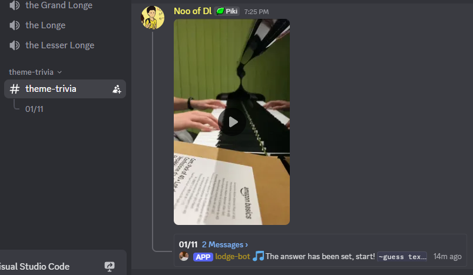

# discord-trivia-bot

Discord bot for posting instrumental videos of game themes and having your friends guess it. Requires an SQL DB.

To setup:
- Create a channel called `theme-trivia` (changeable in config)
- Import `table.sql` to your MySQL DB
- Set SQL credentials/host in the config
- Add users' Discord IDs who will post clips to the `setUsers` config

To use:
- As a user in the `setUser` array, post a video to `#theme-trivia`
- Create a thread from it
- In the thread, post something like `~set game: ocarina of time theme: hyrule field`
  - Sections can be split by `/` for alternate answers: `main theme/title theme/overworld` would all be valid answers
- Everyone else messages the thread with `~guess their guess`
- There are 10 points available for each answer - the game, and the theme. They don't have to be in the same guess
- Guesses have to contain an entire "section" of the keywords - i.e you must include `main theme` from the example above to get the theme point
- `~leaderboard` in the channel to display that
- Incorrect guesses are shamed, and then the available points remaining decreases by 1, floored at 1.